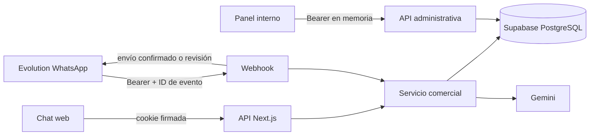

# Arquitectura y decisiones

## Fronteras de confianza

El navegador no conoce credenciales de Evolution ni de Supabase. RLS está habilitada sin políticas permisivas; además se revocan grants del navegador. Las consultas pertenecen al backend con service role, que omite RLS: por eso cada ruta debe autorizar el acceso por sí misma. La sesión web se deriva exclusivamente de una cookie firmada, nunca de un ID indicado en el JSON. WhatsApp identifica el canal solo después de autenticar el emisor y verificar la instancia.

El panel usa una credencial compartida de operador y autoriza acceso a un único negocio. No uses el diseño tal cual en un SaaS multiempresa: necesitarías usuarios, membresías y políticas de propiedad/tenant, además de roles y auditoría por persona.

## Flujo de un turno

1. La ruta limita consumo en PostgreSQL y valida tamaño, roles, contenido y modelo. El cliente no puede insertar mensajes `system`.
2. El servicio crea/recupera conversación por canal y toma un lease exclusivo en una operación SQL atómica.
3. Lee contexto reciente desde el servidor y persiste la entrada. Si está pausado no llama al modelo. Una solicitud explícita de asesor pausa y registra una confirmación.
4. Una palabra comercial crea un lead único por conversación sin sobrescribir su estado posterior. Los datos de catálogo activo alimentan el prompt.
5. La IA tiene un timeout de 25 s, un reintento como máximo y 800 tokens de salida. Un fallo de persistencia impide devolver éxito.
6. En WhatsApp el lease se mantiene también durante el envío externo; el panel no puede tomar un turno a medio enviar. El lease se libera en `finally`. Un proceso caído deja una ventana de bloqueo de 90 s, no un bloqueo indefinido.

Se toma un máximo de 20 mensajes; la entrada web admite 4000 caracteres por mensaje y 16000 en total. La ruta usa solo el último mensaje web y recupera el resto de PostgreSQL. El tamaño máximo del cuerpo se aplica mientras se lee, incluso sin Content-Length.

## Duplicados y efectos externos

WhatsApp primero inserta un evento único `${instance}:${messageId}`. Solo la solicitud que inserta puede generar y enviar. Antes del envío se guarda `sending` y la respuesta; solo un 2xx del proveedor permite marcar `sent`. Un fallo deriva a `review`; si el proceso cae, el registro previo sigue existiendo. Los duplicados pendientes no ejecutan efectos.

La entrega y la actualización SQL no son una transacción distribuida. Si Evolution recibió el mensaje pero se perdió la confirmación, no sabemos si conviene reenviar. El diseño prefiere revisión manual a duplicar mensajes. Esto es deduplicación persistente con conciliación, no una promesa de exactamente una vez ni una cola automática.

## Datos

- `conversations`: identidad de canal, modo humano y lease.
- `messages`: historial privado con borrado en cascada.
- `products`: catálogo comercial administrado por el equipo.
- `leads`: estado comercial único por conversación.
- `webhook_events`: estado durable de procesamiento/entrega para conciliación.
- `rate_limits`: contador por ventana de un minuto, actualizado mediante upsert atómico.

Las funciones SQL son `SECURITY INVOKER`, usan referencias de esquema explícitas y su ejecución está revocada para roles públicos. `consume_rate_limit` y `claim_conversation` se reservan a service role. El esquema completo se ejecuta en una transacción y puede repetirse.

## Decisiones para explicar en entrevistas

- TypeScript describe tipos, Zod valida datos no confiables en ejecución.
- Un contador en memoria no protege varias instancias del backend; PostgreSQL comparte el estado.
- Habilitar RLS no basta si una política permite todo. Usar service role tampoco autoriza al usuario que llama a tu API.
- Un timeout puede ocurrir después de que el sistema remoto realizó el envío. Devolver éxito sin revisar `response.ok` o reintentar sin ID produce errores comerciales reales.
- Los tests con mocks verifican contratos de la aplicación; un motor SQL real detecta errores en permisos y funciones que un mock no detecta. Las pruebas de integración con las cuentas reales siguen siendo necesarias.
